# OLED : RC12 / RC12.1 Lisible / RC12.1 Compact

Images synthétiques à taille native 128 × 64. Aucune validation physique implicite.

[Zoom facultatif dans la galerie HTML](gallery.html).

| Page | RC12 Compact | RC12.1 Lisible | RC12.1 Compact |
| --- | --- | --- | --- |
| main | 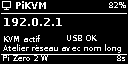 | 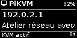 | 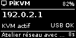 |
| battery | 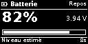 | 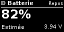 | 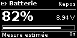 |
| system | 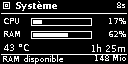 | 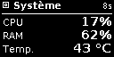 | 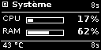 |
| network | 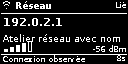 | 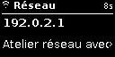 | 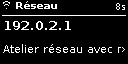 |
| usb | 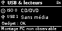 | 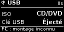 | 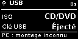 |
| transfer | 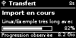 | 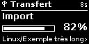 | 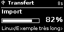 |
| menu | 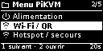 | 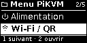 | 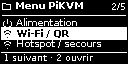 |
| power | 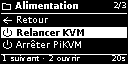 | 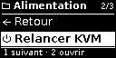 | 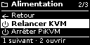 |
| wifi | 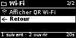 | 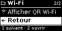 | 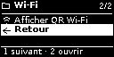 |
| menu-network | 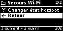 | 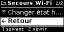 | 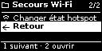 |
| iso-root | 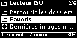 | 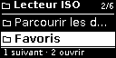 | 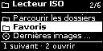 |
| iso | 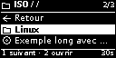 | 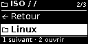 | 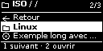 |
| iso-action | 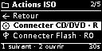 | 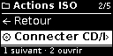 | 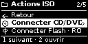 |
| iso-info |  |  | 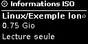 |
| iso-connect-confirm | 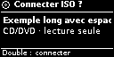 | 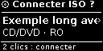 | 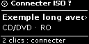 |
| iso-eject-confirm | 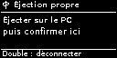 | 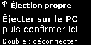 | 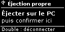 |
| power-confirm |  | 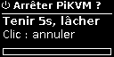 | 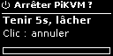 |
| network-confirm |  | 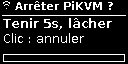 | 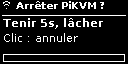 |
| working |  |  |  |
| message |  |  |  |
| qr |  |  |  |
| error |  |  |  |
| notification |  |  |  |
| idle |  |  |  |
| off |  |  |  |
| system_details | Nouvelle page |  |  |
| network_details | Nouvelle page |  |  |
