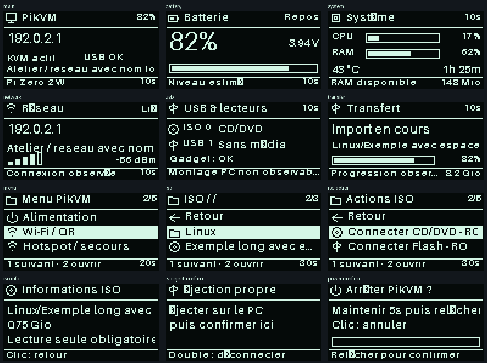

# PiKVM Portable OS 0.2.0-rc.12

RC12 conserve le moteur KVM natif KVMD 4.213, SHARE et les transferts RC10.1,
le lecteur GPIO18 RC8 et les préférences RC11. Aucun script de cette migration
ne configure les GPIO, ne réinitialise les lecteurs, ne reformate une image ou
ne redémarre matériellement le Pi.

## OLED et navigation

Un seul processus (`pikvm-oled-custom`) produit le framebuffer monochrome
128×64 : pages, listes, confirmations, QR et messages. Le même framebuffer,
rotation comprise, est envoyé au worker SSD1306 et au miroir Web. L’absence
du périphérique I2C 0x3C n’arrête pas le rendu ; reconnexion asynchrone toutes
les 30 secondes. Le canvas Web conserve un agrandissement sans interpolation.

Le processus bouton publie uniquement un petit modèle de navigation en mémoire
volatile. Il ne dessine plus et n’arrête/redémarre plus le service OLED pour
ouvrir un menu. Les opérations lentes passent par un seul worker, sans file
illimitée. Le lecteur GPIO18 reste identique à RC11 : HIGH = appuyé, aucune
réservation exclusive ni changement de résistances.

| Geste | Comportement |
| --- | --- |
| Clic simple | Élément suivant. Hors menu : préférence RC11 conservée, `suivant` par défaut pour une nouvelle configuration. |
| Double clic | Ouvrir le menu, le dossier ou les actions sélectionnées. Même origine, session et contexte obligatoires. |
| Maintien 1,2 s puis relâchement | Retour, sans action sensible. Seuil réglable de 0,8 à 2 s. |
| Maintien ≥3 s hors confirmation sensible | Accueil, sans arrêt ni redémarrage. |
| Confirmation « Relancer KVM » | Maintenir 2 s puis relâcher ; ne redémarre que KVMD/nginx. |
| Confirmation arrêt / hotspot | Maintenir 5 s puis relâcher. Clic pour annuler. |

Les actions sensibles exigent une entrée séparée en confirmation. Sur le Web,
une autorisation dédiée à cet écran est également obligatoire. Les gestes sont
mesurés côté serveur, bail de 800 ms, annulation sur perte GPIO, chevauchement
physique/Web, changement de contexte ou pause excessive de la boucle. Aucun
clic simple/double ne coupe l’alimentation. L’arrêt conserve la chaîne existante
et ses gardes contre les deux lecteurs attachés / transferts / SHARE occupé.
La fenêtre du double clic (350 ms, réglable 200–500) retarde volontairement
le clic simple. Les rebonds de relâchement n’allongent pas la durée mesurée.

## Pages et images

Accueil, Batterie, Système (CPU/RAM/température/durée), Réseau et USB partagent
les mêmes composants : titre, icône, contenu borné, aide, sélection inversée et
jauges. Un état inconnu n’est pas présenté comme un zéro. Le transfert n’affiche
que sa progression réellement observée. L’alerte batterie critique reste visible
dans les menus. Le défilement concerne seulement les textes trop longs, au plus
10 Hz ; désactivation globale et OLED, vitesses bornées, styles Compact/Détaillé.



Le gestionnaire ISO utilise la bibliothèque et les routes MSD natives via le
socket Unix KVMD, avec son authentification locale root par UID Unix. Les routes
Web restent protégées par l’authentification KVMD et CSRF. Voir les sources
[MSD KVMD 4.213](https://github.com/pikvm/kvmd/blob/v4.213/kvmd/apps/kvmd/api/msd.py)
et [authentification native](https://github.com/pikvm/kvmd/blob/v4.213/kvmd/apps/kvmd/api/auth.py).

Navigation par dossiers contenant des images, informations, favoris (12 images
maximum plus le dossier favori RC11), historique des 12 dernières connexions,
connexion CD/DVD ou Flash **en lecture seule**, confirmation distincte d’éjection
propre côté PC. Ouvrir le menu ne connecte rien. Les conteneurs cachés, chemins
non canoniques et liens symboliques sont refusés. Aucune suppression OLED.
Les dossiers vides sans image native ne sont pas présentés. Un favori obsolète
reste refusé ; il ne force jamais une connexion. Si l’écriture PST de l’historique
échoue après une connexion réussie, l’interface le signale sans rejouer l’opération.

Les préférences RC11 (ordre, durées, visibilité, thème, inactivité, raccourcis)
migrent en mémoire vers le schéma 2. Les pages Réseau et USB sont initialement
désactivées pour conserver la rotation enregistrée RC11. L’enregistrement
explicite utilise toujours le bail PST natif et la révision concurrente. Les
aperçus de pages et menus dans Paramètres utilisent le même rendu, sur un
brouillon et des données synthétiques, sans action matérielle.

## Mise à jour depuis RC11

La publication ne vaut pas validation sur le Pi. Conserver l’archive et son SHA256,
les rapports de précontrôle et le chemin de sauvegarde de **cette** installation.
Ne pas utiliser `install.sh` pour cette migration.

```bash
# Après transfert de l’archive RC12 et de son fichier .sha256, par SSH à mot de passe :
sha256sum -c pikvm-portable-os-0.2.0-rc.12.tar.gz.sha256
stage=$(mktemp -d /tmp/portable-rc12.XXXXXX)
tar -xzf pikvm-portable-os-0.2.0-rc.12.tar.gz -C "$stage" --strip-components=1
cd "$stage"
sha256sum -c MANIFEST.sha256
bash install-portable-os.sh check
```

Continuer uniquement si les contrôles passent, GPIO17 est OUTPUT HIGH, GPIO18
reste dans sa configuration validée, les deux lecteurs sont libres et aucun
import/transfert ou accès Web SHARE n’est en cours. Le précontrôle refuse les
correctifs locaux OLED inconnus. Avant toute interruption, l’installateur crée
et vérifie la sauvegarde des fichiers et des préférences RC11.

```bash
rw
if bash "$stage/install-portable-os.sh" install; then
    ro
else
    code=$?
    ro
    exit "$code"
fi
bash "$stage/scripts/pikvm-portable-rc12-diagnose.sh"
```

Recharger le navigateur (Ctrl+Maj+R), tester les pages et gestes non sensibles,
prévisualiser puis enregistrer une préférence, vérifier KVM/HID et les deux
panneaux ISO/USB. Tester les ISO réelles seulement manuellement et avec éjection
propre du PC ; les tests automatiques utilisent exclusivement des données isolées.
`/legacy/` et `/kvm/` restent disponibles. Aucun reboot matériel nécessaire.

## Retour RC11

Employer **l’installateur de l’archive RC12**, qui connaît la sauvegarde du
schéma 1. L’ancien installateur RC11 ne restaure pas les préférences de schéma 2.
Libérer les deux lecteurs, SHARE et les transferts avant restauration.

```bash
rw
if python3 -B "$stage/scripts/pikvm-portable-install" restore /root/pikvm-portable-os-backups/DATE-ID; then
    ro
else
    code=$?
    ro
    exit "$code"
fi
```

La restauration vérifie tous les SHA256 avant arrêt des services, restaure les
octets exacts des préférences RC11 sous bail PST, puis les fichiers et états
d’activation des services. Une copie des préférences RC12 est conservée dans
`preferences-before-restore.json`. Répéter la restauration est sans effet
supplémentaire. Si le stage temporaire a disparu, réextraire l’archive RC12.

## Validation et mesures

Tests Python : rendu monochrome exact, métriques de police monochromes,
texte borné, inconnus, caches, I2C absent/reconnecté, gestes rebondis et limites,
origine/session, chevauchement, bail, états USB inconnus, dossiers, images
synthétiques, confirmations, erreurs, migration RC11 et restauration binaire.
Sept suites navigateur couvrent l’OLED RC12 et les régressions natives KVM,
sélecteur ISO, formulaires, transfert, SHARE et Paramètres. Les tests Linux
3.11/3.14 complètent les tests locaux Windows/Python 3.12.

`docs/performance/rc12-local.json` mesure le rendu synthétique sur le PC de
développement ; il ne mesure pas le Raspberry Pi. Sur le Pi, le diagnostic passif
rapporte CPU/PSS/cgroups et le benchmark natif. `button.json` fournit l’âge du
polling, les pauses de boucle et l’échantillonneur ; `frame.json` fournit le délai
entre le relâchement reconnu et la première publication, incluant l’attente du
double clic pour un clic simple. Ce délai n’est pas la latence électrique complète
ni le temps de réception du navigateur. Une validation physique des gestes et
un SSD1306 réellement reconnecté restent nécessaires pour certifier ces parties.
