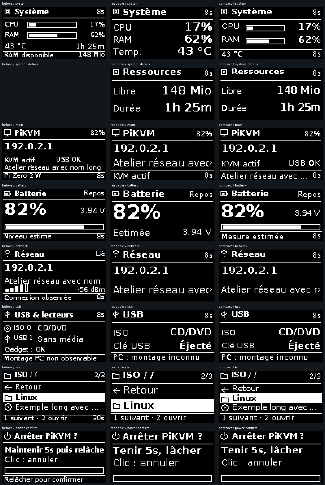

# PiKVM Portable OS 0.2.0-rc.12.1 — Lisibilité OLED

Le framebuffer reste monochrome 128 × 64 et commun au SSD1306 et au miroir Web.
RC12.1 agrandit les informations utiles, sépare les données secondaires et
conserve les gestes RC12. Aucun changement du lecteur GPIO18, du GPIO17, des
services d’alimentation, du moteur KVM, des règles USB ou du stockage SHARE.

## Rendu

Deux profils : **Lisible**, recommandé pour les nouvelles préférences, et
**Compact**. Les valeurs Système passent à 14 pixels en Lisible ; les labels
à 11 pixels. Le mode Compact conserve les jauges CPU/RAM avec des caractères
plus grands qu’en RC12. La ligne mémoire disponible sort du pied de page.

Les pages configurables « Mémoire et durée » et « Connexion et signal »
accueillent les informations secondaires. Accueil, Batterie, USB, transfert,
listes, confirmations, erreurs et inactivité utilisent les mêmes marges,
mesures de police et indicateurs de texte incomplet. Une liste comporte deux
grandes lignes en Lisible ou trois lignes en Compact. Les messages peuvent
employer davantage de lignes lorsque leur hauteur le permet.

Les textes longs défilent seulement si nécessaire, au plus 10 Hz, avec un
indicateur de débordement. Défilement désactivé : ellipse explicite. Les accents
sont normalisés, les glyphes ne sont pas coupés verticalement. Les primitives
monochromes emploient un blanc canonique pour conserver les mêmes bits dans
Pillow, l’image PNG, l’API et le périphérique. Le QR garde quatre modules de
marge blanche, sans interpolation.



[Galerie complète à taille native 128 × 64](images/rc121/gallery.md) : 79 images
de référence/RC12.1, deux profils, menus et confirmations, erreurs, inactivité et
QR de démonstration. Le zoom est facultatif. **Ces données sont synthétiques ;
ces captures ne constituent pas une validation physique.** La référence RC12
est figée dans les tests ; ses blancs sont canonisés pour la comparaison entre
versions de Pillow. Les mêmes polices DejaVu sont utilisées avant/après.

## Préférences et compatibilité

Le schéma 3 accepte la migration et l’import des schémas 1 (RC11) et 2 (RC12).
L’ordre, les durées, la visibilité, le thème, les favoris et les réglages de
gestes sont conservés. Compact reste Compact ; l’ancien style Détaillé devient
Lisible. Les nouvelles pages sont initialement **désactivées** après migration
pour préserver la rotation enregistrée : les activer dans Paramètres → OLED
et écrans, puis régler leur durée. Une lecture seule ne réécrit pas le PST.
Le profil Lisible est recommandé, mais ne remplace pas un Compact enregistré.

Le clic simple, le double clic, le retour long et le retour accueil 3 s sont
inchangés. Les confirmations sensibles gardent leurs seuils 2/5 s, leur
autorisation dédiée, le bail Web 800 ms et les protections de stockage.
Les essais automatiques ne déclenchent aucune action d’alimentation réelle.

## Validation et performances

Tests des deux profils sur toutes les pages : limites 128 × 64, non-chevauchement,
tailles des valeurs, noms ISO longs, données inconnues, messages, jauges,
menus, confirmations, pixels physiques/Web simulés, migration et retour exact
aux préférences RC12. Les régressions Python/JavaScript et navigateur couvrent
également KVM/HID, le sélecteur ISO, SHARE et les transferts.

`docs/performance/rc121-local.json` contient les temps de rendu comparables sur
le PC de développement, et **pas des mesures de CPU du Pi**. La mesure Linux
passive `/proc` avant/après inclut les enfants via les cgroups et relève CPU,
PSS et descripteurs. Les polices et masques sont bornés et mis en cache ; les
pages immobiles ne redessinent pas en continu. Aucune nouvelle dépendance
n’est installée sur le Pi. L’outil de génération du QR de démonstration est
limité au poste de développement.

## Mise à jour RC12 → RC12.1

Utiliser l’archive candidate, jamais `install.sh`. SSH root par mot de passe,
saisi dans la fenêtre native et absent des scripts/journaux. Conserver les
vérifications d’alimentation après l’extinction inexpliquée précédente.

```bash
sha256sum -c pikvm-portable-os-0.2.0-rc.12.1.tar.gz.sha256
stage=$(mktemp -d /tmp/portable-rc121.XXXXXX)
tar -xzf pikvm-portable-os-0.2.0-rc.12.1.tar.gz -C "$stage" --strip-components=1
cd "$stage"
sha256sum -c MANIFEST.sha256
pinctrl get 17
pinctrl get 18
vcgencmd get_throttled
bash install-portable-os.sh check
```

Exiger GPIO17 OUTPUT HIGH, GPIO18 dans sa configuration connue et relâché, les
deux lecteurs éjectés proprement, aucun import et aucun accès Web SHARE. Toute
incompatibilité/état inconnu bloque la suite. Ne pas contourner un échec.

L’installateur copie et vérifie les fichiers remplacés, les préférences PST
brutes et les états des services **avant tout arrêt de service**. Noter le
nouveau chemin `Sauvegarde : /root/pikvm-portable-os-backups/DATE-ID`, qui doit
correspondre à RC12. Une sauvegarde RC10.2 ancienne ne convient pas.

```bash
# Seulement après validation complète et autorisation de déploiement.
rw
if bash "$stage/install-portable-os.sh" install; then
    ro
else
    result=$?
    ro
    exit "$result"
fi
```

La transaction ne relance jamais power-hold et ne redémarre pas matériellement
le Pi. Recharger le navigateur ; vérifier Lisible/Compact, les nouvelles pages
et durées, l’annulation des confirmations, KVM/HID et les lecteurs. Vérifier
services, GPIO, mémoire/CPU et métadonnées des sept ISO et des deux conteneurs.
Tester le SSD1306 lorsqu’il est disponible. Ne pas présenter le miroir seul
comme une validation physique.

## Retour RC12

Libérer les deux lecteurs et les opérations de stockage. Utiliser l’installateur
du **stage RC12.1** : il restaure exactement le schéma 1/2 original sous bail PST.

```bash
rw
if python3 -B "$stage/scripts/pikvm-portable-install" restore /root/pikvm-portable-os-backups/DATE-ID; then
    ro
else
    result=$?
    ro
    exit "$result"
fi
```

La restauration vérifie les sauvegardes avant arrêt des services et conserve
une copie des préférences RC12.1. `/legacy/` et `/kvm/` restent des accès de
secours. Aucun formatage, reset USB, effacement d’ISO ou réinitialisation des
conteneurs n’intervient dans la mise à jour ni dans ce retour.
